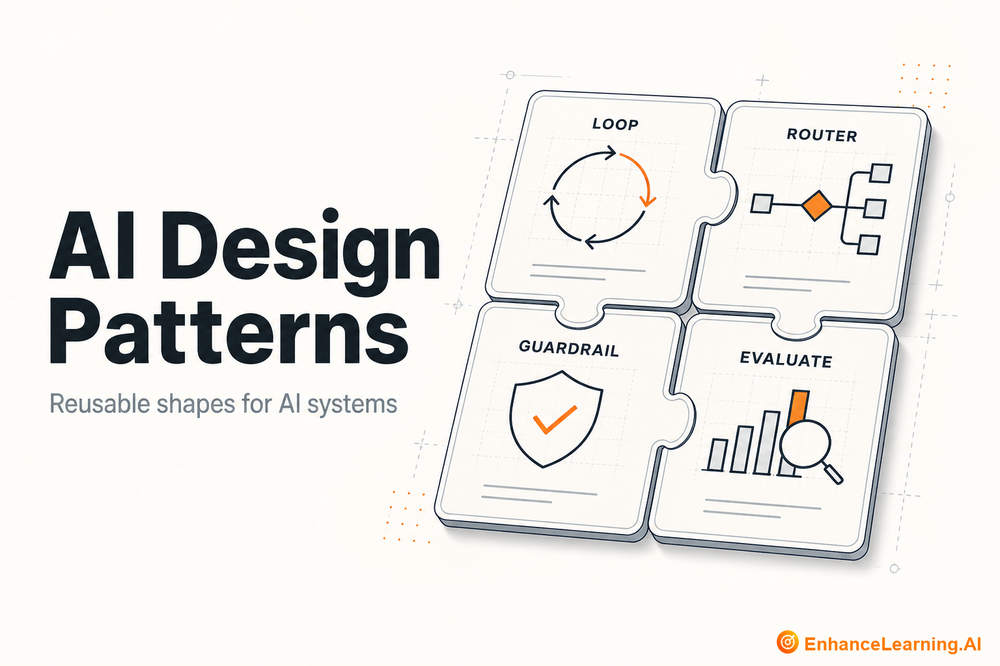

  

# AI Design Patterns: Reusable Shapes for Probabilistic Systems

> Maintained reading path from [EnhanceLearning.AI](https://enhancelearning.ai) — practitioner-grade articles for engineers, architects, and technology leaders building production AI-native systems.

**Topic on the site:** [AI Design Patterns](https://enhancelearning.ai/articles?category=AI+Design+Patterns) · **Full library:** [enhancelearning.ai/articles](https://enhancelearning.ai/articles)

## What this repo is

A curated reading path for **AI Design Patterns**. It is not a code SDK — it points to the foundation deep-dives on [EnhanceLearning.AI](https://enhancelearning.ai) so you can align on concepts, critique designs, and ship production systems that hold up.

Find core patterns, decision frameworks for choosing them, how patterns evolve as models improve, and the hidden costs that sit beyond raw compute.

## Who it's for

Engineers and architects standardizing how AI capabilities are composed inside products.

## Foundation articles

- [Why AI Design Patterns Are Essential for AI-Native Engineering](https://enhancelearning.ai/articles/why-ai-design-patterns-are-essential) — Why pattern literacy is a core competency for AI-native systems: shared control shapes, repeatable behaviour, and governance that survives team handoffs.
- [Core AI Design Patterns Every Team Uses](https://enhancelearning.ai/articles/core-ai-design-patterns) — Router, ReAct, Planner–Executor, and Reflection patterns explained with when to use each, when not to, and a small implementation sketch for production.
- [Prompt Chaining vs Agent Loops: Choosing the Right Control Pattern](https://enhancelearning.ai/articles/prompt-chaining-vs-agent-loops) — When to use fixed prompt chains versus dynamic agent loops — based on task predictability, governance needs, latency, and how much the next step can change.
- [A Decision Framework for Choosing AI Design Patterns](https://enhancelearning.ai/articles/decision-framework-for-ai-design-patterns) — Match AI design patterns to task complexity, risk, latency budget, and operational maturity — so you stop defaulting to planners, critics, and ensembles.
- [Why Every AI Pattern Has Hidden Costs Beyond Compute](https://enhancelearning.ai/articles/why-every-ai-pattern-has-hidden-costs-beyond-compute) — AI design patterns cost more than tokens—latency, maintenance, observability, and cognitive load. Price the full pattern tax before you add another planner.
- [How AI Design Patterns Evolve as LLM Capabilities Improve](https://enhancelearning.ai/articles/how-ai-design-patterns-evolve-as-llm-capabilities-improve) — Which AI design patterns persist, simplify, or fade as LLMs improve—and how to design control shapes that survive capability jumps without endless rewrites.

## More from EnhanceLearning.AI

- Homepage: [https://enhancelearning.ai](https://enhancelearning.ai)
- All articles: [https://enhancelearning.ai/articles](https://enhancelearning.ai/articles)
- This topic filter: [AI Design Patterns](https://enhancelearning.ai/articles?category=AI+Design+Patterns)
